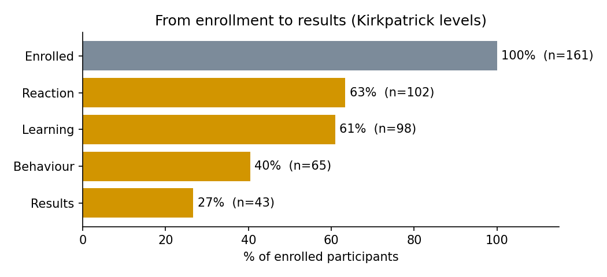
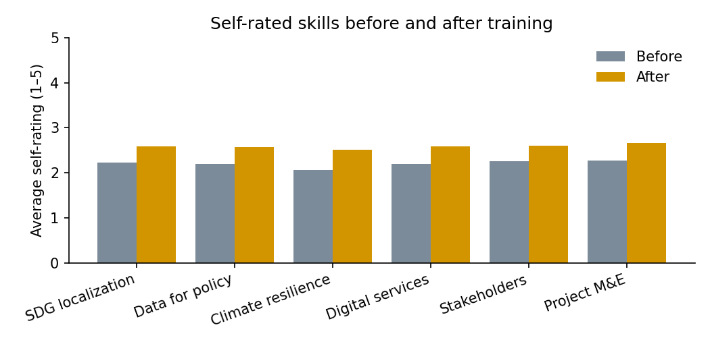
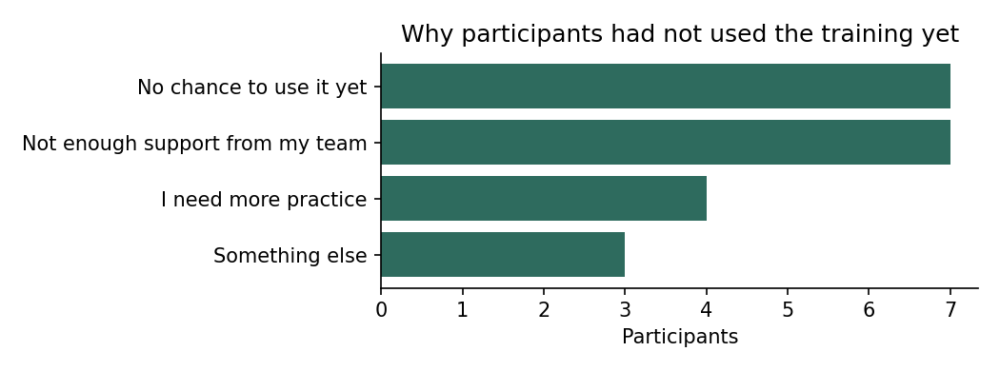

# LearnBridge Training Evaluation Report

Data: 161 enrollments from 120 participants across 6 courses. 86 of 128 participants who completed a course answered the 90-day follow-up.

> The sample data is simulated for demonstration. Run the script on a real export to produce the same report for an actual programme.

## Key findings

- **27% of enrolled participants reported a change in their organisation**, against 63% who rated their course highly. Satisfaction scores alone would overstate the programme's impact.
- The largest drop-off is between **Enrolled** and **Reaction**, so that is where extra support would help most.
- Self-rated skills rose in 6 of 6 areas (6 statistically significant at p < 0.05); the largest average gain was in **Climate resilience**.
- **Planning Resilient Cities** produced the highest average gain in its target skill (+1.37 levels).
- Rating and learning gain are only weakly related (Spearman ρ = -0.11, p = 0.237, n = 115): liking a course is not the same as learning from it.

## 1. From enrollment to results

| Level     | Measure                           |   Count |   Share of enrolled |
|:----------|:----------------------------------|--------:|--------------------:|
| Enrolled  | Started the course                |     161 |               100   |
| Reaction  | Rated the course 4 or 5           |     102 |                63.4 |
| Learning  | Target skill up by 1+ level       |      98 |                60.9 |
| Behaviour | Used it at work within 90 days    |      65 |                40.4 |
| Results   | Reported an organisational change |      43 |                26.7 |

## 2. Did skills improve?

Paired comparison of each participant's first and second self-assessment. dz is the mean change divided by the standard deviation of the change.

| Skill              |   n |   Before |   After |   Change |   Effect size (dz) | p-value   |
|:-------------------|----:|---------:|--------:|---------:|-------------------:|:----------|
| SDG localization   |  95 |     2.22 |    2.59 |     0.37 |               0.61 | < 0.001   |
| Data for policy    |  95 |     2.2  |    2.57 |     0.37 |               0.65 | < 0.001   |
| Climate resilience |  95 |     2.06 |    2.52 |     0.45 |               0.68 | < 0.001   |
| Digital services   |  95 |     2.19 |    2.58 |     0.39 |               0.66 | < 0.001   |
| Stakeholders       |  95 |     2.25 |    2.6  |     0.35 |               0.58 | < 0.001   |
| Project M&E        |  95 |     2.27 |    2.66 |     0.39 |               0.64 | < 0.001   |

## 3. Results by course

Average target gain is the change in the skill each course is designed to build, among participants who completed it; the p-value tests whether that gain differs from zero.

| Course                                        |   Enrolled |   Completed % |   Avg rating |   Avg target gain | p-value   |   Reported change % |
|:----------------------------------------------|-----------:|--------------:|-------------:|------------------:|:----------|--------------------:|
| SDG Localization in Practice                  |         21 |            86 |         4.33 |              1.29 | < 0.001   |                  10 |
| Evidence for Policy: Working with Public Data |         23 |            87 |         3.8  |              1.18 | < 0.001   |                  61 |
| Planning Resilient Cities                     |         22 |            86 |         4.26 |              1.37 | < 0.001   |                  18 |
| Designing Digital Public Services             |         28 |            82 |         4    |              1    | < 0.001   |                  29 |
| Facilitating Multi-stakeholder Dialogue       |         33 |            79 |         3.96 |              1.09 | < 0.001   |                  27 |
| Results-based Project Management              |         34 |            65 |         4.59 |              1.11 | < 0.001   |                  18 |

## 4. What got in the way

## Notes and limitations

- Skills are self-rated, so gains may partly reflect confidence rather than ability.
- Follow-up responses are voluntary; participants who applied the training may be more likely to reply, which would inflate Levels 3 and 4.
- There is no control group, so the analysis shows change after training, not proof that the training caused it.
